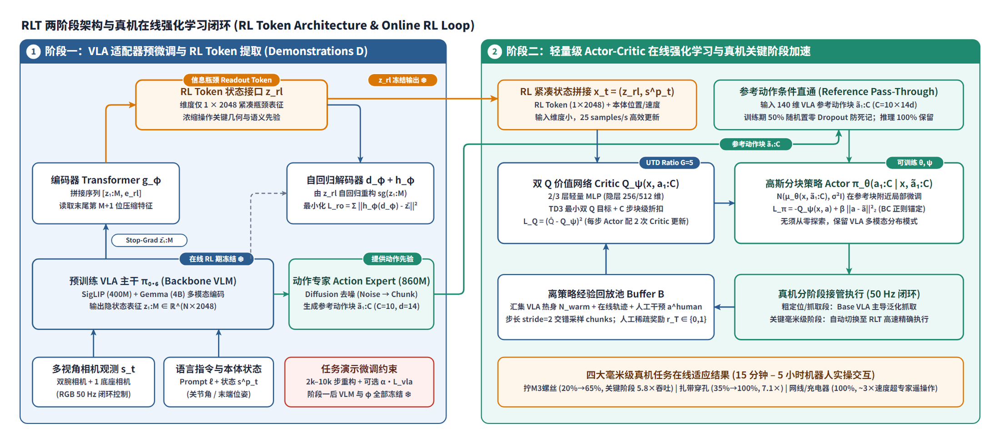
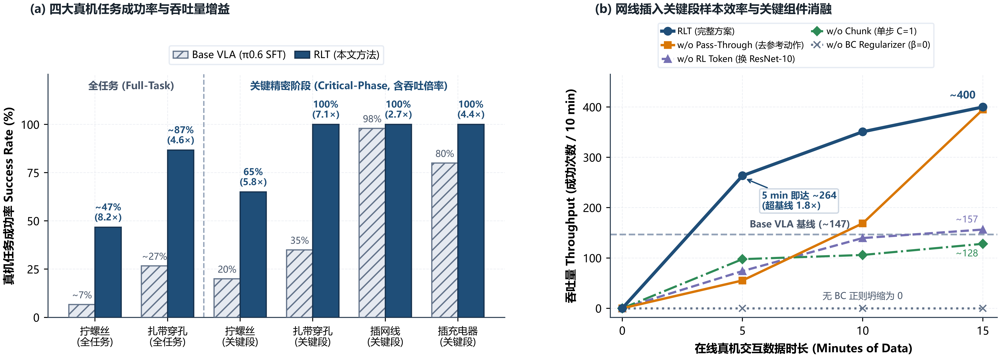

# 《RL Token：用视觉-语言-动作模型自举在线强化学习》精华图文导读

> **原文标题**：*RL Token: Bootstrapping Online RL with Vision-Language-Action Models*  
> **作者**：Charles Xu, Jost Tobias Springenberg, Michael Equi, Ali Amin, Adnan Esmail, Sergey Levine, Liyiming Ke  
> **机构**：Physical Intelligence  
> **论文编号**：[arXiv:2604.23073](https://arxiv.org/abs/2604.23073) · **项目主页**：https://pi.website/research/rlt

---

## 零、一页读懂 RLT（阅读前先建立核心直觉）

1. **痛点是什么？**  
   以 $\pi_{0.6}$ 为代表的大型视觉-语言-动作（VLA）模型虽然“开箱即用”就能完成大范围泛化抓取与语义理解，但在真正决定成败的**“最后一毫米”高精度接触阶段**（如将 M3 螺丝批头对准螺丝孔、把细扎带穿过锁紧孔、快速插拔网线与电源插头）往往表现犹豫、频繁试探回撤甚至失败——模仿学习（BC）的天花板受限于遥操作演示数据的噪声与覆盖度。
2. **为什么简单/传统方案行不通？**  
   - **直接端到端在线 RL 微调几十亿参数 VLA**（如全参 PPO/在线微调）：计算与样本开销极大，无法在真实机器人仅有数十分钟至数小时的交互预算内快速收敛；
   - **直接从头训练小网络（如基于 ImageNet ResNet-10 的 HIL-SERL）或仅靠单步残差/潜噪声调优（PLD、DSRL）**：脱离了 VLA 的多任务表征与多模态分布先验，要么在 50 Hz 高频稀疏奖励下学不动（HIL-SERL 成功率 0%），要么被死死锁在基线速度区间（DAgger/DSRL 难突破专家遥操作速度）。
3. **本文的核心解法与大白话类比**  
   **一句话类比**：“把重达 50 亿参数的通才老专家（VLA）固定在后台做 **视觉理解 + 参考草案**，在前台只提拔一名精干的一线专员（`1×2048` 维 **RL Token** + 轻量级 Actor-Critic 小网络），专盯最难的最后一毫米反复刷题提速。”  
   具体分两步：先在少量任务演示上训练一个编码器-解码器自回归重构瓶颈，从 VLA 隐状态抽取出仅 **`1 × 2048`** 维的高纯度 **RL Token ($\mathbf{z}_{\text{rl}}$)**；随后完全冻结庞大 VLA 主干与特征头，仅基于 $\mathbf{z}_{\text{rl}}$ 与本体状态训练轻量 Actor-Critic。Actor 直接以 VLA 提议的参考动作块 $\tilde{\mathbf{a}}_{1:C}$ 作为输入（Reference Pass-Through），并用 L2 正则锚定在其邻域做“局部策略编辑”。
4. **怎么稳定训出来 / 解锁了什么新能力？**  
   配合 **Chunk 级 Q 学习（$C=10$ 缩短稀疏奖励信用分配视界）**、**50% 参考动作 Dropout（防止 Actor 偷懒直接抄参考动作）**、**Stride-2 交错子采样 + UTD Ratio $G=5$（提高样本利用率）** 以及 **非关键段由 Base VLA 接管、仅在关键精密段触发 RLT** 的分段策略：只需 **15 分钟至 5 小时真实机器人练习**，即可在四大精细任务上实现最高 **3 倍关键段速度提升（吞吐提升 2.7×–8.2×）**，且在网线插入任务上超过**半数回合速度快于所有人类专家遥操作演示**（中位步数 66 步 vs 人类 146 步 vs 基线 228 步）。

> **图 1：RLT 两阶段模型架构与在线强化学习闭环全景图（整合重构自原论文 Fig. 1 `overview.pdf` 与 Fig. 2 `architecture.pdf`）。** **左栏（阶段一）**：展示在少量任务演示 $\mathcal{D}$ 上基于 $\pi_{0.6}$（`SigLIP 400M + Gemma 4B + Action Expert 860M`）拟合编码器-解码器瓶颈以提取 $1 \times 2048$ 维 RL Token $\mathbf{z}_{\text{rl}}$ 的过程；**右栏（阶段二）**：展示冻结 VLA 与 $\phi$ 后，以 $(\mathbf{z}_{\text{rl}}, \mathbf{s}^{\text{p}}_t)$ 与参考动作块 $\tilde{\mathbf{a}}_{1:C}$ 驱动轻量级 Actor-Critic 在真实机器人关键阶段完成离策略在线提升的闭环。**视觉编码**：深海蓝代表骨架网络与 Critic，琥珀橙突出信息瓶颈 $\mathbf{z}_{\text{rl}}$ 与核心真机结果，松石绿对应动作产生与参考直通通路，珊瑚红提示阶段二起主干全冻结（❄）。**核心结论**：RLT 以 2048 维紧凑状态接口与动作块级局部编辑，将原本难以实时收敛的大模型在线 RL 转化为分钟级可落地的轻量适配闭环。

---

## 一、研究动机与核心问题

### 1.1 摘要（Abstract 精译）
视觉-语言-动作（VLA）模型能够“开箱即用”地掌握多样化操作技能，但要达到真实任务所要求的毫米级精度与执行速度，仍需进一步后训练（例如强化学习 RL）。本文提出一种轻量级方法 **RLT（RL Token）**，仅依靠数小时真实机器人练习即可对大型预训练 VLA 进行高样本效率的在线 RL 微调：
1. 适配预训练 VLA，使其暴露一个紧凑的读出表征 **“RL Token”**，在保留任务相关先验知识的同时充当在线 RL 的高效状态接口；
2. 基于该 RL Token 训练小型 Actor-Critic 头来精炼动作，同时将学到的策略锚定回原 VLA。

在**拧 M3 螺丝、穿绑扎带、插电源充电器与插网线**四项真实机器人高精密操作任务上，RLT 在数分钟至数小时实践内将关键难点阶段的执行速度最高提升 **3 倍**，显著拉高成功率，甚至在部分任务上**超越了人类专家遥操作演示的速度**。

### 1.2 为何既不能“全参训 VLA”，也不能“只靠小网络从头学”？
- **通用 VLA 的“最后一毫米”困境**：在 $\pi_{0.6}$ 等大规模多任务策略中，诸如抓取、粗定位等前置阶段（spanning 30–120 s，即 1500–6000 步 @ 50 Hz）已具备极强鲁棒性；但真正决定成败的**关键接触阶段（Critical Phase，约 5–20 s / 250–1000 步）**受限于人类演示数据中微小的手眼抖动与覆盖盲区，策略常表现得过度试探（“靠近 → 轻微回缩 → 微调 → 重试”的循环）。
- **现有两类微调范式的局限**：
  - **全量微调路线**（如 RECAP / DPPO / SimpleVLA-RL）：需海量数据与高算力回传，不适合真实物理硬件受限预算下的在线快速自愈；
  - **从零轻量 RL / 单步微调路线**（如 HIL-SERL、PLD、DSRL）：HIL-SERL 依赖 ImageNet 预训练小 ResNet，丢失 VLA 的几何与语义操作结构先验；PLD 与 ConRFT 采用单步动作（$C=1$）难以在 50 Hz 长视界稀疏二值奖励下回传有效 Q 值梯度；DSRL 仅在扩散噪声潜空间里做模态重排，无法发现超越原始演示速度的新接触策略。

---

## 二、核心方法与公式逐项拆解

RLT 的核心设计哲学可以概括为：**最大化榨取冻结预训练 VLA 的视觉-语言表征与行为先验，同时把在线参数更新严格限制在可高速收敛的小型 MLP 策略与价值网络内部**。

### 2.1 阶段一：改造 VLA 暴露紧凑的 RL Token 接口（Eq. 1–2）

设基于 $\pi_{0.6}$ 的预训练 VLA（视觉骨干 `SigLIP 400M` + 语言骨干 `Gemma 4B` + 扩散动作专家 `860M`）对多视角图像观测 $s$ 与语言指令 $\ell$ 输出最后一层视觉 Token 隐表征 $\mathbf{z}_{1:M} = \{\mathbf{z}_1, \dots, \mathbf{z}_M\} \in \mathbb{R}^{N \times 2048}$。RLT 在其上方外挂一组轻量级编码器-解码器 Transformer（参数量记为 $\phi$）：将可学习的特殊查询向量 $\mathbf{e}_{\texttt{rl}} = \mathbf{e}_\phi(\texttt{<rl>})$ 拼接到 $\mathbf{z}_{1:M}$ 末尾送入编码器 $g_\phi$，抽取末位第 $M+1$ 个输出向量作为唯一的 **`1 × 2048` 维 RL Token**：

$$\mathbf{z}_{\text{rl}} \;=\; g_\phi\!\bigl([\mathbf{z}_{1:M},\;\mathbf{e}_\texttt{rl}]\bigr)_{M+1} \tag{1}$$

随后，配对的解码器 Transformer $d_\phi$ 与线性投影头 $h_\phi$ 被训练为**仅凭 $\mathbf{z}_{\text{rl}}$ 信息瓶颈自回归地重构原始 VLA 隐状态**（对 VLA 目标 $\bar{\mathbf{z}}_i = \mathrm{sg}(\mathbf{z}_i)$ 施加停止梯度）：

$$\mathcal{L}_{\text{ro}}(\phi) = \mathbb{E}_{\mathcal{D}}\!\Bigl[\, \sum_{i=1}^{M} \bigl\lVert h_\phi\bigl(d_\phi([\mathbf{z}_{\text{rl}},\,\bar{\mathbf{z}}_{1:i-1}])\bigr)_{\!i} - \bar{\mathbf{z}}_i \bigr\rVert^2 \,\Bigr] \tag{2}$$

在目标任务的少量演示数据 $\mathcal{D}$ 上，可联立最小化 $\mathcal{L}_{\text{ro}}(\phi) + \alpha \mathcal{L}_{\text{vla}}(\theta_{\text{vla}})$ 微调 2,000–10,000 步（之后**同时永久冻结 $\theta_{\text{vla}}$ 与 $\phi$**）。

> [!TIP]
> **💡 读懂公式 (1)–(2)**
> - 为什么要“编码器压缩 + 解码器重构”而不是直接对 $\mathbf{z}_{1:M}$ 做平均池化？直接池化会把大片无用桌面背景噪声与关键夹爪/插孔微区等权混杂；强迫单个 $\mathbf{z}_{\text{rl}}$（$1 \times 2048$）通过自回归解码器还原整幅画面的高维 Token 序列，就逼着注意力头只保留足以支撑动作生成的**高信息密度空间语义瓶颈**。
> - 注意原文脚注细节：因每个微调任务指令固定，阶段一提取 RL Token 时直接丢弃语言 Token、仅编码多视角图像 Token 嵌入（见原论文 Fig. 2 `image embeddings N × 2048`）。

### 2.2 阶段二：动作块级 Actor-Critic 与参考动作条件直通（Eq. 3–5）

在 50 Hz 控制频率下，$\pi_{0.6}$ 单次预测 $H=50$ 步（1 秒，$d=14$ 维动作空间）。为兼顾反应敏捷度与稀疏奖励下的时间差分（TD）回传效率，RLT 令 Actor $\pi_\theta$ 与双 Q 集成 Critic $Q_\psi$ 统一工作在更短的 **RL 动作块长度 $C=10$（0.2 s，共 $10 \times 14 = 140$ 维）** 上。状态输入为紧凑拼接 $\mathbf{x} = (\mathbf{z}_{\text{rl}}, \mathbf{s}^{\text{p}})$（即 `1×2048` 维 RL Token + 本体位置与速度）。

**Critic 价值更新（遵循 TD3 最小双 Q 目标 + $C$ 步块级折扣）**：

$$\mathcal{L}_Q(\psi) = \mathbb{E}_{(\mathbf{x}, \mathbf{a}_{1:C}, \mathbf{x}') \sim \mathcal{B}} \Big[\big(\hat{Q}-Q_\psi(\mathbf{x}, \mathbf{a}_{1:C})\big)^2\Big], \quad \hat{Q} = \sum_{t'=1}^{C} \gamma^{t'-1} r_{t'} + \gamma^C \mathbb{E}_{\mathbf{a}' \sim \pi_\theta}\Big[Q_{\psi'}(\mathbf{x}', \mathbf{a}')\Big] \tag{3}$$

**Actor 策略参数化与局部锚定目标（核心机制）**：  
与常见“只输入状态 $\mathbf{x}$ 的残差缩放策略”不同，RLT 直接让高斯策略同时以状态 $\mathbf{x}$ 与基线 VLA 采样的参考动作块 $\tilde{\mathbf{a}}_{1:C} \sim \pi_{\mathrm{vla}}(\cdot \mid \mathbf{s}, \ell)$ 为条件输入：

$$\pi_\theta\bigl(\mathbf{a}_{1:C} \mid \mathbf{x}, \tilde{\mathbf{a}}_{1:C}\bigr) = \mathcal{N}\Bigl(\mu_\theta\bigl(\mathbf{x}, \tilde{\mathbf{a}}_{1:C}\bigr),\, \sigma^2 \mathbf{I}\Bigr) \tag{4}$$

并在目标函数中将最大化 $Q$ 值与面向 $\tilde{\mathbf{a}}_{1:C}$ 的 L2 行为克隆（BC）正则项结合起来：

$$\mathcal{L}_{\pi}(\theta) = \mathbb{E}_{\substack{\mathbf{s} \sim \mathcal{B} \\ \mathbf{a}_{1:C} \sim \pi_\theta}}\left[-\,Q_\psi(\mathbf{x}, \mathbf{a}_{1:C}) + \beta \left\|\mathbf{a}_{1:C} - \tilde{\mathbf{a}}_{1:C}\right\|_2^2\right], \quad \tilde{\mathbf{a}}_{1:C} \sim \pi_{\mathrm{vla}}(\cdot \mid \mathbf{s}, \ell) \tag{5}$$

> [!TIP]
> **💡 读懂公式 (3)–(5) 与三大工程绝招**
> 1. **为何“输入参考块 $\tilde{\mathbf{a}}_{1:C}$ + L2 正则”比直接输出残差 $\Delta \mathbf{a}$ 更强？** 单模态高斯直接拟合多模态人类操作分布会崩塌；把采样自流匹配/扩散专家的 $\tilde{\mathbf{a}}_{1:C}$ 喂进网络并辅以 $\beta$ 正则，既天然继承了多模态模式选择，又不被手调残差边界框死上限（允许在真机探索中大步提速）。
> 2. **参考动作随机置零（Reference Action Dropout）**：如果在 Critic 还没学准之前就一味把 $\tilde{\mathbf{a}}$ 喂给 Actor 并叠加 $\beta \|\mathbf{a}-\tilde{\mathbf{a}}\|_2^2$，Actor 会学会“原样复制输入通道”。RLT 在**训练批中以 50% 概率将 $\tilde{\mathbf{a}}_{1:C}$ 置零掩码（推理期 100% 保留）**，强制网络建立独立的视觉状态-动作映射通道，一旦 $Q_\psi$ 发现比 $\tilde{\mathbf{a}}$ 更快的插接路径便立即果断偏离基线提速。
> 3. **高效离策略与分段接管系统设计**：回放池 $\mathcal{B}$ 混合了先期 Base VLA 热身数据（$N_{\text{warm}}$）、在线 RL 自主探索与人类遥操作干预（干预期间 $\tilde{\mathbf{a}} \leftarrow \mathbf{a}^{\text{human}}$）；每步对连续轨迹以 **`stride = 2` 交错子采样 chunk**（等效 25 samples/s），并用高更新数据比 **UTD Ratio $G=5$（Critic 与 Actor 更新频次比 2:1）** 榨干每一次真实触碰经验。训练收尾后还可用人工接管时刻作为监督标签，微调 Base VLA 使其在全任务部署时**自动识别何时将控制权交接给 RLT**。

### 2.3 模型架构与关键训练超参速查表

| 类别 | 超参数 / 组件配置 | 具体取值 / 设计说明 |
| :--- | :--- | :--- |
| **基础 VLA 骨干** | 预训练模型 | $\pi_{0.6}$（视觉 `SigLIP 400M` + 语言 `Gemma 4B` + 动作专家 `860M`） |
| **观测输入配置** | 相机视角 + 本体状态 | 2 个腕部广角相机 + 1 个底座相机；状态含关节位置（Screw）或末端位姿与速度（另三项） |
| **RL Token 接口** | 编码器-解码器维度 | 从 $N \times 2048$ VLA 隐状态压缩出 $1 \times 2048$ 紧凑向量 $\mathbf{z}_{\text{rl}}$（阶段一微调 2k–10k 步后全冻结） |
| **动作空间与分块** | 控制频率 / 分块视界 | 50 Hz Delta 动作控制（$d=14$）；Base VLA $H=50$（1 s），RL 分块 $C=10$（0.2 s，共 140 维） |
| **Actor-Critic 结构** | 网络容量与双 Q 集成 | 扎带 / 网线 / 充电器：2 层 MLP（隐宽 `256`）；拧螺丝：3 层 MLP（隐宽 `512`）；TD3 双 Q 取最小值 |
| **防抄袭掩码机制** | Reference Action Dropout | 训练批 `50%` 概率把参考块 $\tilde{\mathbf{a}}_{1:C}$ 置零；实机推理期 `100%` 传入 |
| **样本效率加速** | 交错采样与 UTD | `stride=2` 交错入池（约 25 samples/s）；异步收集+更新，高更新比 $G=5$，Critic/Actor 比例 2:1 |
| **奖惩与交互规模** | 稀疏奖励与实际交互时长 | 人类操作员在回合末打二值标签 $r_T \in \{0,1\}$；每任务 400–1000 回合（约 15 分钟 – 5 小时真机交互） |

---

## 三、核心实验结果、效率与消融分析

论文在**拧 M3 螺丝（Screw installation）**、**扎带穿锁孔（Zip tie fastening）**、**网线插入（Ethernet insertion）**与**电源充电器插入（Charger insertion）**四大高难度真实物理任务上验证 RLT，分为仅隔离精密段的 **Controlled Critical-Phase（每组 50 回合）** 与从 Home 位点完整执行的 **Full-Task（先由 $\pi_{0.6}$ 抓取对齐、关键段交接给 RLT）** 两套评测体系。

> **图 2：真实机器人主实验对比与关键设计组件消融分析（严格依据原论文矢量 PDF 图表 Fig. 4 `rlt_success_rate_all.pdf`、Fig. 5 `rlt_throughput_all.pdf` 与 Fig. 6 `throughput_ablations.pdf` 坐标校准复绘）。** **(a) 左子图**：对比 Base VLA ($\pi_{0.6}$ SFT) 与 RLT 在全任务（左侧 2 组）及关键精密阶段（右侧 4 组）的真机成功率（柱高）及关键阶段吞吐量提升倍比（柱顶深蓝括号标注）；**(b) 右子图**：展示网线插入任务前 15 分钟真实机器人数据采集过程中的吞吐量学习曲线（成功次/10 min）与四大组件消融。**视觉编码**：深海蓝实心/实线固定标识完整 RLT，灰色斜线/虚线为 Base VLA 基线，橙/紫/绿折线分别对应剥离各关键组件的变体（凡原图未印刷文本小数的柱状图及折线图点均标以 `~` 图读近似前缀）。**核心结论**：RLT 在全部 6 项真机评估中均全面大幅超越 Base VLA；仅凭 **5 分钟** 关键段在线交互即以 `~264` 吞吐反超 Base 基线（`~147`）达 **1.8×**，15 分钟收尾达 `~400`（`~2.7×`）。

### 3.1 四大真机任务成功率与吞吐量总表（含全任务泛化检验）

> 下表中标注 `~` 前缀的数值为依据原论文矢量 PDF（Fig. 4 & Fig. 5）网格坐标精密校验读数，其余为 `.tex` 正文逐字明确报告数值。

| 评测范围 | 任务名称 | Base VLA ($\pi_{0.6}$) 成功率 | **RLT (本文) 成功率** | Base 吞吐 (次/10分) | **RLT 吞吐 (次/10分)** | 吞吐加速比 |
| :--- | :--- | :---: | :---: | :---: | :---: | :---: |
| **全任务 (Full-Task)** | **Screwdriver（拧 M3 螺丝）** | ~6.7% | **~46.7%（+40%）** | ~1.7 | **~14.0** | **~8.2×** |
| **全任务 (Full-Task)** | **Zip Tie（扎带穿孔锁紧）** | ~26.7% | **~86.7%（+60%）** | ~2.8 | **~13.0** | **~4.6×** |
| **关键段 (Critical-Phase)** | **Screwdriver（拧 M3 螺丝）** | 20% | **65%** | ~6.7 | **~39.0** | **~5.8×** |
| **关键段 (Critical-Phase)** | **Zip Tie（扎带穿孔锁紧）** | ~35% | **100%** | ~16.9 | **~120.0** | **~7.1×** |
| **关键段 (Critical-Phase)** | **Ethernet（插网线入接口）** | ~98% | **100%** | ~147.0 | **~400.0** | **~2.7×** |
| **关键段 (Critical-Phase)** | **Charger（插充电器入排插）** | ~80% | **100%** | ~136.0 | **~600.0** | **~4.4×** |

### 3.2 与主流机器人 RL / 模仿学习基线对比（Ethernet 任务）

| 方法 | 核心机制与决策粒度 | 成功率 (Success Rate) | 吞吐量 (次/10分) | 核心表现归因 |
| :--- | :--- | :---: | :---: | :--- |
| **Base VLA ($\pi_{0.6}$)** | 纯演示行为克隆 (SFT) | ~98% | ~147 | 接触瞬间反复试探回撤（中位耗时 228 步） |
| **HIL-SERL** | ImageNet ResNet-10 + 单步 RL | 0% | 0 | 50 Hz 高频长视界 + 无动作边界裁剪，稀疏奖下完全学不动 |
| **PLD** | 冻结 VLA + 单步残差 $C=1$ | ~40% | ~44 | 单步微调信用分配极慢，仅 40% 收敛 |
| **DAgger** | Base VLA 混合人类干预数据微调 | **100%** | ~180 | 模仿学习速率上限受限于人类示教本身速度 |
| **DSRL** | 潜扩散噪声空间在线寻优 | ~98% | ~210 | 仅在 VLA 原有行为模式内挑选噪声，难挖掘更果断高速的新策略 |
| **RLT (Ours)** | **RL Token + $C=10$ 分块 + Pass-Through** | **100%** | **~400** | 涌现新顺应推挤策略，**中位仅 66 步（人类专家中位 146 步）** |

### 3.3 组件消融与涌现行为（Emergent Behavior）深度剖析
- **BC 正则项（$\beta > 0$）决定生死**：移除 BC 正则（$\beta=0$，`w/o BC Regularizer`）导致在 `140` 维高维块空间内失去有效先验约束，成功率和吞吐量全程 **坍缩为 0%**。
- **RL Token 相比通用视觉特征的碾压级优势**：将 `1×2048` 的 RL Token 替换为 ImageNet 预训练 `ResNet-10`（`w/o RL Token`）后，15 分钟网线任务最终吞吐量暴跌 **~50%（仅 ~156.5 vs RLT ~400.0）**，证实自回归重构瓶颈保留了不可替代的精微操作表征。
- **参考动作直通（Pass-Through）与分块（Chunk $C=10$）缺一不可**：去掉参考动作输入（`w/o Pass-Through`）虽然在较简单的网线任务上经过 15 分钟也能勉强追上终点速度（~394.9），但 5 分钟与 10 分钟前期吞吐严重滞后（~55.3 / ~168.8 vs RLT ~263.5 / ~350.8），且探索阶段频发早期偏航失败；退回单步动作（`w/o Chunk`）则因稀疏奖励传播链拉长导致 15 分钟仍被锁死在 ~128 吞吐（低于 Base 基线）。
- **超越人类示教的涌现策略（Fig. 8 原图实测）**：在 Ethernet 关键插入段，Base VLA 平均需要 **228 步（约 4.56 s）** 完成，人类专家遥操作中位数为 **146 步（约 2.92 s）**，而 RLT 仅需中位数 **66 步（约 1.32 s，速度为 Base 的 3.45×）**——半数以上 RL 回合比**最快的专家遥操作演示还要快**。定性观察发现，人类或基线遇到卡阻会退回重新对准，而 RLT 自主演化出了**在轻触阻力后持续施加前向微压力伴随小幅度高频抖动（wiggling to exploit compliance）**的顺应性滑入动作。

---

## 四、局限性、核心术语对照与 5 点实战启发

### 4.1 原文坦陈的局限性与未来方向
1. **仍依赖人工监督信号**：在线阶段依赖操作员在关键段人工标定稀疏成功/失败标签 $r_T$、必要时实施遥操作保护干预、并人工指派从 Base VLA 交接至 RL 阶段的分界点（作者指出未来可由 VLM 奖励模型与进度预测器自动化）。
2. **RL Token 当前按单任务演示分别适配**：尚未跨任务及跨构型（Embodiment）验证单个通用 RL Token 的零样本泛化性；且在线收集到的高速优胜轨迹反哺回基座 VLA（形成数据飞轮，见原 `.tex` 中讨论的思想），尚未在本论文实验主表中全部自动化闭环。

### 4.2 核心术语中英对照速查

| 英文术语 | 中文译名 | 一句话工程解释 |
| :--- | :--- | :--- |
| **RL Token ($\mathbf{z}_{\text{rl}}$)** | RL 读出令牌 | 通过自回归重构编码器-解码器从 $\pi_{0.6}$ 隐层压缩抽取出的 `1×2048` 维紧凑特征向量，作为轻量 RL 状态。 |
| **Critical Phase** | 关键精密阶段 | 整个长程任务中耗时仅 5–20 s、但对毫米级接触对齐与成败起到决定性瓶颈作用的核心段落（如插拔、拧紧）。 |
| **Reference Pass-Through** | 参考动作条件直通 | 把冻结 VLA 采样的 $\tilde{\mathbf{a}}_{1:C}$ 直接拼入 RL Actor 输入层，以继承多模态行为分布并辅以 50% 随机置零防抄袭。 |
| **TD3 Dual-Q + Chunking** | 分块双 Q 价值学习 | 在 $C=10$ 步动作块尺度下执行截断双 Q 时间差分备份，将 50 Hz 长视界稀疏奖传播难度骤降 10 倍。 |
| **UTD Ratio ($G=5$)** | 高更新数据比 | 配合 `stride=2` 交错子采样回放池，对每份真机采样数据异步执行 5 倍频次梯度的激进策略价值更新。 |

### 4.3 给 VLA / 机器人真机微调研究者的 5 点实战启发
1. **做 $\pi_0 / \pi_{0.5} / \pi_{0.6}$ 真机在线 RL 时，千万别傻训主干、也别迷信 ResNet 重训**：先用本任务的 `2k–10k` 步自回归 Token 重构头抽一个 **`1×2048`（或适配隐藏宽）低维瓶颈接口**再冻结大模型，是在 1 小时真机寿命内吃透预训练语义的最短路径。
2. **“状态给 Token + 输入喂参考动作 + Dropout 50% + L2 正则”是工程上极具威力的组合拳**：比单纯残差叠加 $a = \tilde{a} + \alpha \cdot \Delta a$ 更不挑手调尺度 $\alpha$，既保住训练前 5 分钟不摔机（靠 $\beta$ 拉住），又允许后期在毫秒接触上完全突破基线速度天花板。
3. **Chunk + Stride 子采样是 50 Hz 稀疏奖励落地的硬通货**：在物理机上不要用 50 Hz 单步 Bellman 更新；按 `C=10` 规划 chunk 同时以 `stride=2` 向 Replay Buffer 密度注入交错切片 transitions，能在不降反应力的前提下大幅加快 Q 值回传。
4. **不要让 RL 去学本来已经能做好的一切前置步骤**：像本文一样采取 **“Base VLA 抓起并走近 → 仅对最后 5–20 秒精密接触段启用 RL”** 的分段分权，然后用人类接管点反过来微调 VLA 学一个自动切换开关，是提升真机实验成功概率与设备安全性的黄金工程守则。
5. **警惕只看静态 SR 不看 Throughput 与步数直方图**：像网线插入这类 VLA 成功率本已高达 98% 的任务，RL 的核心价值体现在通过**顺应性物理交互消除犹豫重探**（吞吐翻 2.7×–4.4×），评估与刷榜务必把平均耗时与成功率并重指标放进主实验框图。
