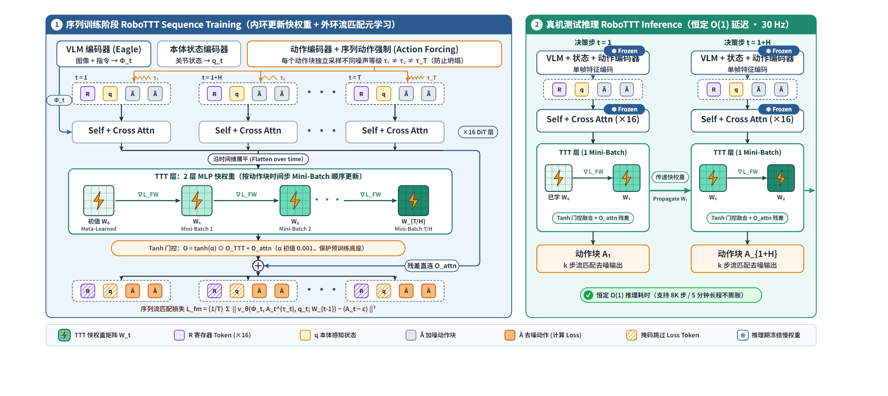
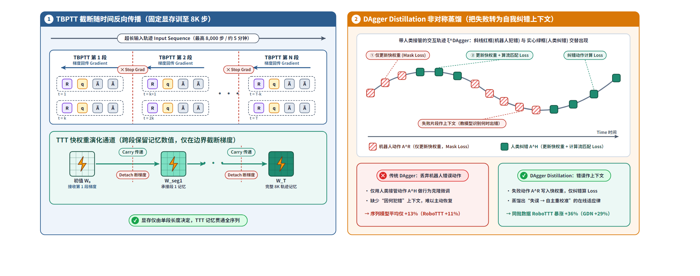
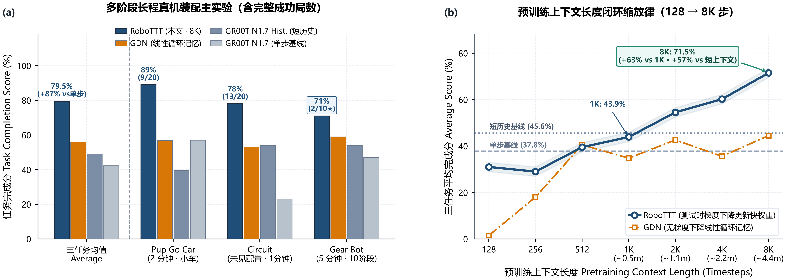
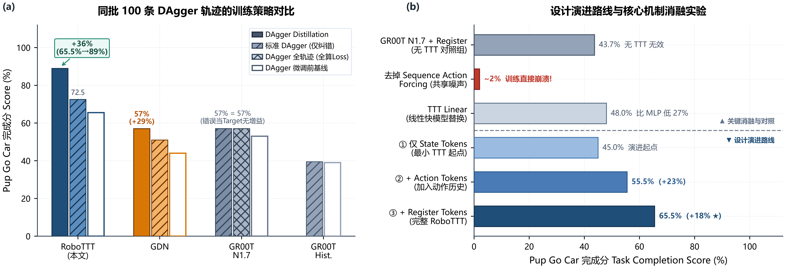

# 《RoboTTT：面向机器人策略的上下文缩放》完整中文精译与深度导读

> **原文标题**：*RoboTTT: Context Scaling for Robot Policies*
> **全称**：*Test-Time-Training Robot Policies*（测试时训练机器人策略）
> **作者**：Yunfan Jiang¹,², Yevgen Chebotar¹, Ruijie Zheng¹, Fengyuan Hu¹, Yunhao Ge¹, Jimmy Wu¹, Tianyuan Dai¹,³, Scott Reed¹, Li Fei-Fei²,†, Yuke Zhu¹,³,†, Linxi "Jim" Fan¹,†
> **机构**：¹NVIDIA · ²Stanford University · ³The University of Texas at Austin（†共同指导）
> **论文编号**：[arXiv:2607.15275](https://arxiv.org/abs/2607.15275) · **项目主页**：[research.nvidia.com/labs/gear/robottt](https://research.nvidia.com/labs/gear/robottt/)

---

## 零、一页读懂 RoboTTT（阅读前先建立核心直觉）

在进入逐章精译之前，先用 4 句话抓住整篇论文最核心的骨架：

1. **痛点是什么？现有 VLA 机器人模型基本都是“失忆症患者”**
   目前主流的机器人基础模型（如 GR00T N1.7、$\pi_0$、OpenVLA）在决策时通常只看**当前这一帧**或过去 2–8 帧的图像。如果让机器人做需要 5 分钟、10 个步骤的复杂装配，它很容易“忘记自己刚才拧没拧螺丝”“分不清视觉长得差不多的两个阶段”，更没法看一遍人类示范视频就照着做。
2. **为什么不能直接套用大模型的长上下文 Transformer？**
   如果把过去几千帧图像全塞进 Transformer 的 KV Cache，推理延迟会随时间线性暴涨，真机 30 Hz 实时控制根本跑不动；而传统循环网络（LSTM 或线性注意力 GDN）虽然速度恒定，但“记忆容量小、不会挑重点”，面对机器人高帧率、高度重复的视频流容易遗忘或学出虚假相关性。
3. **RoboTTT 的核心解法：把“记忆”存进实时微调的神经网络权重（快权重 / Fast Weights）里**
   - **慢权重（Slow Weights）**：VLM、DiT 的注意力层等主干参数，训练完后在真机部署时**冻结不动**。
   - **快权重（Fast Weights，$W_t$）**：在 DiT 动作头的每一层后面插入一个小型 2 层 MLP（TTT 层）。无论训练还是**真机测试推理期间**，每收到新的观测，这个小 MLP 都会用**一步梯度下降**现场更新自己的参数 $W_{t-1} \to W_t$。
   - **直觉类比**：慢权重就像“考前复习完就合上的大脑长期知识”，而快权重就像“考场上边做题边实时记笔记的动态草稿纸”。历史越长，草稿纸体积永远固定（$O(1)$ 恒定推理延迟），却能把长达 **8,000 个时间步（约 4–5 分钟）**的关键历史压缩进非线性神经网络的参数空间里。
4. **如何稳定训出 8K 步并解锁涌现能力？**
   - **Sequence Action Forcing（序列动作强制）**：序列里每个动作块必须**各自独立采样不同的加噪程度**，否则共享同一噪声等级会导致整条轨迹同时太简单或太难，训练直接崩溃。
   - **TBPTT（截断反向传播）**：把 8K 步切段算梯度以锁死显存，但段与段之间把快权重 $W_t$ **数值继续往后传**（只截断梯度 `detach`），从而在固定显存下训练任意长上下文。
   - **掩码损失（Loss Masking）解耦上下文与模仿目标**：某些时间步只更新快权重、不算动作 Loss。把人类示范视频放前面做纯上下文 → 解锁**单样本人类视频模仿**；把机器人自己做错的动作放进去做纯上下文、只对人类纠错算 Loss → 提出 **DAgger Distillation**，让机器人在测试时学会“发现失误→自主退回重来”。

> **图 1：RoboTTT 时空解耦架构、$\tanh$ 门控与测试时 $O(1)$ 推理流程（综合原论文 Fig. 2 与 Fig. 3）。** **左栏（序列训练）**：VLM、本体状态与动作编码器将多模态输入转为 Token，其中序列动作强制模块为每个时间步独立采样不同加噪等级 $\tau_t$；每步的注意力层（`Self + Cross Attn`）仅在单帧内交互，随后沿时间展平并逐动作块通过 2 层 MLP 快权重更新（$\nabla\mathcal{L}_{\mathrm{FW}}$）；Tanh 门控将快权重特征与 `O_attn` 残差融合，并在输出端屏蔽寄存器/状态 Token（斜线），仅对去噪动作计算流匹配损失。**右栏（真机推理）**：所有慢权重组件（深蓝标 `❄ Frozen`）完全冻结，每步仅将更新后的固定大小快权重 $W_t$ 向下一决策步传递，支持长达 8K 步 / 5 分钟长程操作而保持恒定推理延迟。

---

## 摘要（Abstract）

近期主流的机器人基础模型通常仅在单步（single-step）或短历史（short-history）的视觉-运动（visuomotor）上下文中运行。本文提出**测试时训练机器人策略（Test-Time-Training Robot Policies，简称 RoboTTT）**，一套包含模型架构与训练配方的完整方法，能够在**不增加推理延迟**的前提下，将视觉-运动上下文规模扩展至 **8K 个时间步**——比当前最先进的策略高出三个数量级。

在这一上下文尺度下，RoboTTT 解锁了全新的机器人能力：基于人类示范视频的单样本上下文模仿（one-shot in-context imitation）、部署期实时自我改进（on-the-fly policy improvement）、对外部扰动的强鲁棒性，以及在多阶段、长程任务上的显著性能提升。我们同时**首次观察到**：随着预训练上下文长度的扩展，机器人的闭环（closed-loop）执行性能呈现出持续稳定的增长。

在核心机制上，RoboTTT 将**测试时训练（Test-Time Training, TTT）**集成到视觉-语言-动作（VLA）等机器人基础模型中，构建出一种循环状态由**快权重（fast weights）**组成的序列模型。快权重在训练和推理阶段均通过梯度下降动态更新，将历史交互信息压缩至权重空间，并在需要时检索上下文信息以实现长程条件控制。为了支持超长训练上下文的扩展，我们的训练配方结合了**序列动作强制（sequence action forcing）**与**截断随时间反向传播（truncated backpropagation through time, TBPTT）**。

在极具挑战性的真实机器人操作任务中，RoboTTT 的综合性能比单步上下文基线高出 **87%**，并成功完整完成了一项长达 **5 分钟、跨越 10 个阶段**的装配任务——而所有基线方法均未能哪怕完整成功一次。使用 8K 时间步预训练的 RoboTTT 比使用 1K 时间步预训练的同构模型性能高出 **62%**（正文按精确比值四舍五入记为 63%，即 71.5% 对比 43.9%），这表明**上下文长度（context length）**正成为机器人基础模型一条全新的缩放轴（scaling axis）。

---

## 1. 引言（Introduction）

当前最先进的机器人基础模型大多只依赖单步或极短历史的视觉-运动上下文（如 GR00T、$\pi_0$、$\pi_{0.5}$、OpenVLA、SmolVLA、RT-1/2、Octo 等）。相比之下，在大语言模型（LLM）领域，上下文长度已经成为一条至关重要的缩放轴。尽管机器人领域的长期推理有时可以交给外部记忆库（external memory banks）处理，但原生的长视觉-运动上下文对于诸多核心能力依然不可或缺：例如从人类示范视频中实现单样本上下文模仿、从机器人自身部署历史中实现实时自我改进，以及在多阶段长程任务中获得更强的闭环执行表现。这自然引出了一个核心问题：**我们如何构建能够学习并有效利用任意长上下文的视觉-运动策略？**

为了回答这一问题，我们提出 **RoboTTT（测试时训练机器人策略）**——一套在**不增加推理延迟**的前提下将视觉-运动上下文扩展至 **8K 时间步**（称为 **RoboTTT-8K**，超越现有 SOTA 策略三个数量级）的模型与训练方案。在这一尺度下，RoboTTT 展现出多项全新的机器人能力：

- **单样本人类视频上下文模仿**：仅凭一段上下文中的人类示范视频，就在 10 次未见配置测试中成功 **6 次**，而基线方法全部失败（0/10）。
- **部署期实时策略改进**：在经过专门的上下文纠错蒸馏训练后，性能比未做该项训练的同构模型提升 **36%**。
- **外部扰动鲁棒性**：面对人为破坏（如拆走已装好的车顶或轮胎），总体恢复成功率达到 **83%**（33/40），而最佳短上下文基线仅为 **53%**（21/40）。
- **多阶段长程任务**：综合任务完成分比单步上下文基线提高 **87%**，并能端到端完成持续超过 **5 分钟、包含 10 个阶段**的双臂灵巧装配任务（所有基线完整成功次数均为 0）。
- **首次验证闭环上下文缩放律**：随着预训练上下文长度增长，闭环任务表现稳步上升——**RoboTTT-8K** 的任务完成分比 **1K 上下文**预训练的同构模型高出 **63%**，比最佳短上下文基线高出 **57%**，表明上下文长度可以成为机器人基础模型新的缩放维度。

在核心原理上，RoboTTT 将**测试时训练（TTT）**融入 VLA 等机器人基础模型中。RoboTTT 本质上是一个循环状态由**快权重（fast weights）**构成的序列模型：与推理阶段完全冻结的**慢权重（slow weights）**不同，快权重在训练和推理时都会通过梯度下降不断更新。这一设计一举攻克了长上下文视觉-运动策略面临的三大难题——**足够大的历史编码容量**、**真正用上历史条件**，以及**推理耗时不随上下文变长而增加**：

1. **高容量压缩**：由快权重参数化的“快模型”（例如两层 MLP），表达容量远超传统循环神经网络（RNN）的向量隐状态。
2. **动态去冗余**：机器人观测和动作流高度密集且重复，在部署期在线训练快模型能够主动保留关键特征、丢弃冗余噪声。
3. **恒定 $O(1)$ 推理复杂度**：随时间向前传递固定大小的快权重矩阵，推理计算量与历史长度无关；而标准 Transformer 即便使用 KV Cache，其推理延迟也会随历史长度线性增长。

更关键的是，借助部署期持续学习的能力，RoboTTT 开启了全新的上下文自适应与策略自我改进范式：它既可以把人类演示新任务构型的视频作为上下文实现单样本模仿，也可以通过 **DAgger Distillation（DAgger 蒸馏）**——将 DAgger 式“失败动作 → 人类纠错”的映射关系蒸馏进快权重——学会在真机运行中自主纠错。而在训练侧，我们结合**序列动作强制（sequence action forcing）**与**截断随时间反向传播（TBPTT）**，使得训练上下文长度可以持续增长而无需增加 GPU 显存开销。

---

## 2. 预备知识（Preliminaries）

### 2.1 测试时训练机制（Test-Time Training Mechanism）

测试时训练（TTT）引入了在训练与推理期间均动态更新的**快权重（fast weights）**来建模上下文，以区别于仅在训练期更新、推理期冻结的**慢权重（slow weights）**。

形式化地，考虑一个 $d$ 维 Token 序列 $X$，通过慢权重投影矩阵 $\theta_Q, \theta_K, \theta_V$ 得到查询、键、值序列 $Q, K, V$，其中 $Q_t, K_t, V_t$ 表示第 $t$ 个时间步的投影结果。快权重 $W$ 参数化了一个小型神经网络 $f_W(\cdot): \mathbb{R}^d \to \mathbb{R}^d$（例如线性层或两层 MLP）。

在时间步 $t$，首先执行**更新（update）**操作，让快模型拟合从键 $K_t$ 到值 $V_t$ 的映射：

$$
W_t \leftarrow W_{t-1} - \eta \nabla_W \mathcal{L}_{\mathrm{FW}}\big(f_{W_{t-1}}(K_t), V_t\big) \tag{1}
$$

其中 $\mathcal{L}_{\mathrm{FW}}(\hat{v}, v) = \|\hat{v} - v\|^2$ 为自监督均方误差（MSE）损失，$\eta$ 为（可学习的）内环学习率。随后，使用更新后的快权重 $W_t$ 执行**应用（apply）**操作，计算当前步输出 $O_t$：

$$
O_t = f_{W_t}(Q_t) \tag{2}
$$

这一“先更新、再查询（update then apply）”的操作在训练与推理时完全一致。

> [!TIP]
> **💡 读懂公式 (1) 和 (2)：TTT 到底在干嘛？**
> 可以把 $f_W$ 想象成一本**神经网络版的键值笔记本**：
> - **写笔记（公式 1）**：当前帧进来后，算出 $(K_t, V_t)$，拿梯度下降让小网络 $f_W$ 记住“看到 $K_t$ 应该输出 $V_t$”，记忆就写进了权重 $W_t$ 里。
> - **查笔记（公式 2）**：拿着当前查询 $Q_t$ 去问刚更新完的小网络 $f_{W_t}(Q_t)$，它就能结合刚刚写进去的以及之前所有历史压缩在权重里的信息，吐出上下文特征 $O_t$。
> - **谁决定“记什么、忘什么”？** 外层的慢权重 $\theta_Q, \theta_K, \theta_V$ 和初始快权重 $W_0$ 是由最终的机器人动作任务损失端到端反向传播学出来的（即“学会怎么记笔记”的元学习）。推理时无需保存历史所有 $K, V$，只需把更新后的小矩阵 $W_t$ 交给下一帧即可。

### 2.2 机器人序列模型（Robot Sequence Models）

本文研究以自身执行历史（rollout history）为条件的机器人策略，即机器人序列模型。一条机器人轨迹记为 $\xi = \{(o_t, q_t, A_t)\}_{t=1}^{T}$，由图像观测 $o_t$、本体感知状态 $q_t$ 与动作块（action chunk）$A_t$ 组成（此处暂略语言指令以简化符号）。我们的目标是学习策略 $\pi(A_t \mid \xi_{<t}, o_t, q_t)$，使其以第 $t$ 步之前的全部历史 $\xi_{<t}$ 及当前观测为条件输出动作块，并将可处理的上下文长度 $|\xi_{<t}|$ 大幅扩展。

---

## 3. 方法：测试时训练机器人策略（Method: RoboTTT）

本节详细介绍 RoboTTT 的四个核心组成部分：模型架构、面向超长序列的训练配方、基于上下文掩码的新能力解锁（人类视频单样本模仿与 DAgger 蒸馏），以及工程实现细节。

### 3.1 模型架构（Model Architecture）

RoboTTT 在保持与原基础模型完全兼容的前提下，将 TTT 层无缝集成到 VLA 等机器人基础模型中，因此适用于广泛的主干架构。本文中，我们将 RoboTTT 实例化在 **GR00T N1.7** 之上。

#### 1) 面向机器人动作的时空解耦 TTT 设计

RoboTTT 由一个视觉-语言模型（VLM）主干（Eagle）和一个带 TTT 层的扩散变换器（Diffusion Transformer, DiT）动作头组成。在每个时间步 $t$，模型预测一个长度为 $H$ 的动作块 $A_t = [a_t, \dots, a_{t+H-1}]$。

我们在每个 DiT 层的自注意力（self-attention）和交叉注意力（cross-attention）之后插入一个 TTT 层，形成清晰的**时空职责分工**：
- **注意力层（Attention）负责单步空间与跨模态交互**：DiT 的输入是跨越 $T$ 个时间步的轨迹 $[R_1, \Phi_1, q_1, \tilde{A}_1, \dots, R_T, \Phi_T, q_T, \tilde{A}_T]$，其中 $\Phi_t$ 是 VLM 输出的视觉-语言（VL）特征 Token，$q_t$ 是编码后的本体状态 Token，$\tilde{A}_t$ 是加噪后的动作块 Token，而 $R_t$ 是在每个时间步最前面拼接的 **$N = 16$ 个可学习寄存器 Token（Register Tokens）**。在单步内，注意力层仅让当前步的 $R_t, q_t, \tilde{A}_t$ 互相做自注意力，并与当前步的 VLM Token $\Phi_t$ 做交叉注意力。
- **TTT 层负责跨时间维度建模**：将各时间步的注意力输出沿时间维拼接展平为 $X = [R_1, q_1, \tilde{A}_1, \dots, R_T, q_T, \tilde{A}_T]$，送入 TTT 层以**小批次（mini-batch，每个动作块时间步为一个 mini-batch）**的方式按顺序执行快权重更新（公式 1）与查询输出（公式 2）。

> [!NOTE]
> **为什么不把 VLM 的图像 Token $\Phi_t$ 直接送进 TTT 层？**
> 4 个相机每帧的 VLM Token 数量非常庞大，全部过 TTT 层计算开销过高。RoboTTT 的巧思在于：每步只加 **16 个可学习的 Register Tokens $R_t$**，先让它们在单步 Cross-Attention 里把当前帧的关键视觉-语言信息“吸干压缩”，再只把轻量级的 $[R_t, q_t, \tilde{A}_t]$ 送进 TTT 层沿时间传递——既省算力，又在消融实验中带来了 **+18%** 的关键提升！

#### 2) 保护预训练能力的 $\tanh$ 门控机制（Gating）

为了避免新插入的随机初始化 TTT 层在训练初期破坏原 GR00T N1.7 已学好的操作能力，RoboTTT 借鉴 Flamingo 引入逐通道可学习的 $\tanh$ 门控。对每一层 DiT，引入初始化为接近零（`0.001`）的向量 $\alpha \in \mathbb{R}^d$，将 TTT 输出与注意力输出残差融合：

$$
O = \tanh(\alpha) \odot O_{\mathrm{TTT}} + O_{\mathrm{attn}} \tag{3}
$$

训练刚开始时 $\tanh(\alpha) \approx 0$，模型表现几乎完全等同于原版 GR00T N1.7；随着训练推进，网络自主决定在每一层给历史记忆打开多大的“阀门”。

---

### 3.2 RoboTTT 序列训练（Sequence Training）

我们在完整的机器人轨迹序列上训练 RoboTTT，让快权重在每条序列内部发生真实的连续更新，从而同时学好**最优初始快权重 $W_0$** 与**更新动力学（$\theta_Q, \theta_K, \theta_V, \eta$）**。

具体而言，给定一条包含共享语言指令 $l$ 的轨迹 $\xi = \{(l, o_t, q_t, A_t)\}_{t=1}^{T}$：
- **内环（Inner Loop）**：TTT 层按时间推进，用自监督均方误差 $\mathcal{L}_{\mathrm{FW}}$ 将快权重从 $W_0$ 逐步更新为 $W_1, W_2, \dots$。
- **外环（Outer Loop）**：在每个时间步计算动作流匹配（Flow Matching）任务损失 $\ell_t$，并对整条序列取平均后做反向传播：

$$
\mathcal{L}_{\mathrm{fm}}(\xi; W_0) = \frac{1}{T}\sum_{t=1}^{T} \ell_t\big((l, o_t, q_t, A_t); W_{t-1}\big) \tag{4}
$$

由此，投影矩阵直接受外环任务梯度优化，而初始快权重 $W_0$ 则通过“梯度的梯度（gradients of gradients，类似 MAML 元学习）”得到优化，使快权重的测试时更新法则专门适配机器人轨迹建模。

#### 关键技术一：序列动作强制（Sequence Action Forcing）

RoboTTT 采用流匹配目标训练动作头：对真实动作块 $A_t$ 加入噪声得到 $\tilde{A}_t = A_t^{\tau} = \tau A_t + (1 - \tau)\epsilon$，其中 $\tau \in [0, 1]$ 为噪声时间步，$\epsilon \sim \mathcal{N}(\mathbf{0}, \mathbf{I})$。

我们在序列训练中发现了一个生死攸关的细节：**必须为序列中每一个时间步的动作块独立采样不同的噪声等级 $\tau_t$**（我们称之为**序列动作强制**，呼应视频扩散中的 Diffusion Forcing）。如果整条序列共享同一个噪声等级，会导致某些训练步整条轨迹都极易（低噪声）或极难（高噪声），梯度方差失控、训练极不稳定（消融实验证实去掉它后任务分数直接跌至接近 0%）。

综上，记 DiT 动作头为 $v_\theta$，完整序列流匹配损失为：

$$
\mathcal{L}_{\mathrm{fm}}(\xi; W_0) = \frac{1}{T}\sum_{t=1}^{T} \mathbb{E}_{\tau_t, \epsilon}\left[\left\|v_\theta(\Phi_t, A_t^{\tau_t}, q_t; W_{t-1}) - (A_t - \epsilon)\right\|^2\right] \tag{5}
$$

其中每个 $\tau_t$ 独立采样自 $\tau_t = s(1 - u)$，$u \sim \mathrm{Beta}(1.5, 1)$，$s = 0.999$。

#### 关键技术二：截断随时间反向传播（TBPTT）

若在长达 8K 步的序列上做完整随时间反向传播（Full BPTT），GPU 必须缓存每一步的中间激活值，显存随序列长度爆炸。RoboTTT 采用 **TBPTT** 解决这一瓶颈：

> **图 2：超长序列显存解耦训练（TBPTT）与非对称纠错蒸馏机制（综合原论文 Fig. 4 与 Fig. 6）。** **左栏（TBPTT）**：8K 步长轨迹被划分为若干段，外环任务梯度仅在单段内回传并在红色虚线边界处以 `Stop Grad` 阻断；下方 TTT 快权重在跨段时对梯度执行 `Detach`，但将更新后的权重数值状态无损 `Carry` 至下一段，且初值 $W_0$ 依然通过第 1 段接收元学习梯度。**右栏（DAgger Distillation）**：在人机交替接管的轨迹中，斜线红框代表机器人错误动作 $A^{\mathrm{R}}$（只写入快权重充当上下文，屏蔽流匹配损失），实心绿框代表人类纠错动作 $A^{\mathrm{H}}$（既更新快权重又计算流匹配损失），相比传统丢弃错误段的 DAgger 将 RoboTTT 增益从 `+11%` 提升至 `+36%`。

- 将长序列切分为多个固定长度的段落（Segments），外环反向传播梯度只在各自段内流动，**显存占用完全由单段长度决定，与总上下文长度解耦**。
- **关键之处**：跨越段落边界时，只对快权重做梯度截断（`detach`），但**快权重的数值状态原封不动地继续向后传递（Carry）**。因此 TTT 的测试时学习会无缝跨越整条 8K 步长序列；同时，初始快权重 $W_0$ 依然可以通过第 1 段持续获得梯度更新。

#### 推理流程（Inference）

真机部署时，每条任务回合（rollout）从学好的 $W_0$ 出发。每当到达新的控制步 $t$，冻结的慢权重先提取当前单帧特征，TTT 层在当前观测上做一次快权重更新 $W_{t-1} \to W_t$ 并通过 $k$ 步流匹配去噪生成动作块 $A_t$，然后将更新后的快权重 $W_t$ 传递给下一个决策步 $t+H$。无论任务执行 10 秒还是 5 分钟，单步计算量与延迟始终保持严格恒定。

---

### 3.3 从上下文中高效学习（Effective Learning from Context）

RoboTTT 的架构天然实现了**快权重更新**与**慢权重监督目标**的解耦：只要对某些指定时间步**屏蔽（mask）流匹配损失**，这些时间步就只充当“纯上下文”——它们照常更新快权重 $W_t$，但不强迫策略去模仿这些步的动作。这一简洁机制直接解锁了两项强大能力：

#### 1) 基于人类示范视频的单样本上下文模仿（One-Shot In-Context Imitation）

我们将展示同一任务配置的一段**人类徒手示范视频** $\xi^{\mathrm{video}}$ 拼接在一条**机器人执行轨迹** $\xi^{\mathrm{robot}}$ 之前，组成一条长序列进行训练：
- **前半段（人类视频）**：屏蔽动作流匹配损失，仅让画面流过网络并不断更新快权重 $W_t$。
- **后半段（机器人轨迹）**：在承接了人类视频快权重的状态下，正常计算机器人的动作流匹配损失。

经过配对训练后，模型学会了从上下文视频中自动提炼目标配置与装配顺序。测试时，只需把一段**从未见过的新配置**的人类示范视频先“喂”给机器人的快权重，机器人就能在不改变语言提示词的情况下一次性照着完成装配。

#### 2) DAgger Distillation（DAgger 蒸馏：在线自我改进）

考虑通过 DAgger 采集的带人类纠错的机器人执行轨迹 $\xi^{\mathrm{DAgger}} = \{(l, o_t, q_t, A_t)\}_{t=1}^{T}$，其中每个执行动作块 $A_t$ 要么是机器人自己做的次优/错误动作 $A_t^{\mathrm{R}}$，要么是人类接管给出的纠错动作 $A_t^{\mathrm{H}}$。

- **传统 DAgger 的浪费**：只拿人类纠错段 $A_t^{\mathrm{H}}$ 做微调，直接扔掉机器人犯错的片段 $A_t^{\mathrm{R}}$——但恰恰是那些犯错动作，才解释了人类**为什么**要这样纠错！
- **DAgger Distillation 的非对称用法**：
  - **快权重更新**：覆盖**整条轨迹**（包括机器人自己的错误动作 $A_t^{\mathrm{R}}$ 和人类纠错 $A_t^{\mathrm{H}}$）。
  - **动作模仿损失（Flow-Matching Loss）**：**只掩码保留人类纠错动作 $A_t^{\mathrm{H}}$**，屏蔽机器人错误动作。

> [!IMPORTANT]
> **为什么这一招本质上是机器人领域的“算法蒸馏（Algorithm Distillation）”？**
> 通过“**犯错过程当上下文、纠错动作当监督目标**”的非对称设计，人类“看到某种失误 → 做出对应补救”的在线策略改进过程被直接蒸馏进了快权重的更新动力学里。到了真机测试时，即使没有人类接管，一旦机器人自己犯了错（如电钻拧偏了螺丝），它的失误动作本身就会写入快权重，紧接着快权重自动触发“抬起手臂 → 重新对齐 → 再次尝试”的恢复动作，且它自己的纠错行为又会继续写入历史！

---

### 3.4 实现细节（Implementation Details）

- **主干与参数规模**：基于预训练 **GR00T N1.7**，在其全部 **16 层 DiT** 中逐层添加 1 个 TTT 层；每个快模型为带 GeLU 激活的 **2 层 MLP**。原 DiT 参数量 `538M`，每层 TTT 约增 `10M`，动作头总计 `690M`。
- **预训练**：在桌面双臂机器人数据与第一视角人类视频数据（EgoScale）的混合集上，逐步拉长上下文至目标长度（RoboTTT-8K 达 8K 步），在 **16 张 NVIDIA GB200** 上预训练 **30K 步**（仅训练新增 TTT/GDN 层，冻结 GR00T 原权重）。
- **后训练**：在下游真实任务上以 **1K 上下文长度**在 8 张 GB200 上全参数微调 **20K 步**。

---

## 4. 实验（Experiments）

### 4.1 实验设置

- **硬件平台**：YAM 双臂桌面机器人，配备 **4 路 RGB 相机**（顶视、底视、左腕、右腕，RealSense D405，480p，RTX 5090 @ 30 Hz 闭环控制）。
- **三大高难度多阶段长程双臂装配任务**：
  1. **Pup Go Car（小车装配）**：采 8 小时真机数据，单局平均 **2 分钟**。需完成抓车顶、对准螺丝孔、拿电钻拧紧、左右手交接电钻、单手翻转车身、装轮胎、再用电钻拧紧轮胎等 14 个细粒度子步骤。
  2. **Circuit（电路板拼装）**：采 6 小时数据，单局平均 **1 分钟**。包含红/绿/彩 LED、灯泡、马达、导线、按钮、开关等元件，共有约 **80 种**组合与装配顺序配置（**仅训练 20 种，全部在未见过的 60 种新配置上测试**），包含开关时还需通电点亮。
  3. **Gear Bot（齿轮机器人完整装配）**：采 5 小时数据，单局平均 **5 分钟**、横跨 **10 个阶段**。双面各装 1 个齿轮和 2 个轮子、两次翻转底盘、安装红色机器人头，最后拿起遥控器推摇杆让小车开动。
- **对比基线**：
  1. **GR00T N1.7**：单步上下文基线（仅看当前帧）。
  2. **GR00T N1.7 Hist.**：短历史基线（额外拼接 1 帧历史图像）。
  3. **GDN（Gated DeltaNet）**：将 RoboTTT 的 TTT 层等参数量、等位置、等门控替换为线性复杂度的门控 DeltaNet 循环记忆层（**无测试时梯度下降**）。
- **评测指标**：Pup Go Car 与 Circuit 各测 20 局，Gear Bot 测 10 局；同时报告**完整成功局数**与基于精细评分细则的**任务完成分（0%–100%）**。

---

### 4.2 主实验：长程灵巧装配任务全面领先

#### 表 1：三项长程装配任务的完整成功次数与任务完成分汇总

| 方法 | Pup Go Car 成功局数 | Circuit（未见配置）成功局数 | Gear Bot（5分钟10阶段）成功局数 | **三任务平均完成分**（图 5 柱状图读数） |
| :--- | :---: | :---: | :---: | :---: |
| **RoboTTT（本文）** | **9 / 20** (~89%) | **13 / 20** (~78%) | **2 / 10** (~71%) | **79%** |
| GDN（无梯度下降循环记忆） | 3 / 20 (~57%) | 8 / 20 (~53%) | 0 / 10 (~59%) | 56% |
| GR00T N1.7 Hist.（短历史） | 0 / 20 (39.5%) | 8 / 20 (~54%) | 0 / 10 (~54%) | 49% |
| GR00T N1.7（单步） | 3 / 20 (57.0%) | 3 / 20 (~23%) | 0 / 10 (~47%) | 42% |

- **定量结果**：RoboTTT 平均任务完成分达 **79%**，比单步基线 GR00T N1.7（42%）高出 **87%**，比最强循环记忆基线 GDN（56%）高出 **41%**，且在所有任务上完整成功局数均居第一；在 5 分钟的 Gear Bot 任务上，**RoboTTT 是唯一能端到端完全做完的方法（2/10）**，其余所有基线均为 0/10。
- **三大定性能力跃升**：
  1. **精准进度追踪与状态消歧**：多阶段装配中不同阶段外观高度相似（状态混叠），基线经常做错动作或跳步；RoboTTT 的快权重实时记住已完成步骤，准确判断当前所处阶段。
  2. **策略性自我恢复**：在 Pup Go Car 拧车顶螺丝时若电钻没对准，RoboTTT 会主动抬臂、重新校准再试；基线则往往“假装拧好了”直接进入下一阶段。
  3. **细粒度操作与抗遮挡**：插入和卡扣电路元件时精度更高，因为长上下文保留了物体被夹爪遮挡前的空间观测信息。
- **为什么简单拼历史（Hist.）和线性记忆（GDN）都不够？**
  - 在 Pup Go Car 上，拼一帧历史的 GR00T Hist.（39.5%）反而大幅输给单帧版 GR00T（57%），因为直接拼接历史帧极易引入虚假相关性，导致推理时落入时序分布外（OOD）。
  - GDN 与 RoboTTT 同样拥有固定大小的状态，唯一核心区别在于更新法则：GDN 的线性关联更新在长达数千步的高冗余机器人视频流中难以提取非线性结构，而 RoboTTT 用**测试时梯度下降更新非线性 MLP 快权重**是表达力强得多的压缩器。

---

### 4.3 首次验证闭环上下文缩放律（Context Scaling）

将 RoboTTT 与 GDN 的预训练上下文长度从 **128 步**（几秒）一路扩展到 **8K 步**（超过 4 分钟），随后在三项任务上进行微调与闭环测试（注：此处所有评估均未使用 DAgger）：

| 预训练上下文长度 | 128 | 256 | 512 | **1K** | 2K | 4K | **8K** | 参考线 |
| :--- | :---: | :---: | :---: | :---: | :---: | :---: | :---: | :--- |
| **RoboTTT 平均完成分** | ~31% | ~29% | ~39.5% | **43.9%** | ~54.5% | ~60.2% | **71.5%** | 单步基线 ~37.8% |
| **GDN 平均完成分** | ~1.5% | ~18% | ~40.5% | ~34.8% | ~42.6% | ~35.6% | ~44.5% | 短历史基线 **45.6%** |

- **清晰且未饱和的缩放趋势**：RoboTTT 从 1K 步（43.9%）开始持续单调攀升，到 8K 步达到 **71.5%**——比 1K 预训练版本高出 **63%**，比最佳短上下文基线（45.6%）高出 **57%**，且在 8K 处仍未见饱和迹象！
- **GDN 毫无缩放收益**：GDN 即使拉到 8K 也始终徘徊在 35%–45% 之间，未能超越短历史基线。
- **原理解析**：
  1. RoboTTT 的外环损失在越来越长的序列上通过更多内环梯度步去**元学习**快权重初始化 $W_0$ 与更新动力学，因此上下文越长，学到的在线学习算法越强；而 GDN 的线性关联规则没有这种梯度元学习机制。
  2. 当预训练上下文低于 1K 步（约半分钟，短于最短任务回合）时，推理时快权重更新步数和位置编码都会大幅超出训练所见范围，导致外推退化。

> **图 3：主实验综合性能与闭环上下文长度缩放律（基于原论文 Fig. 5 与 Fig. 7 精确数据重绘）。** **面板 (a)** 展示三项真机装配任务上的评分完成分与完整成功局数：RoboTTT 平均分达 `79%`（领先单步基线 `+87%`），且是唯一在 5 分钟 10 阶段 `Gear Bot` 任务上取得完整成功（`2/10`）的策略。**面板 (b)** 展示将预训练上下文从 `128` 步扩展至 `8K` 步（约 4.4 分钟）的闭环演化轨迹：RoboTTT 呈现单调且尚未饱和的缩放增长（`1K→8K` 提升 `+63%`，超越最强短历史基线 `+57%`），而无梯度下降更新的 GDN 始终停滞在虚线以下。

---

### 4.4 单样本人类视频模仿与外部扰动鲁棒性

#### 1) 单样本人类视频上下文模仿（Circuit 未见配置）

在训练集中为每个配置额外采集 5–20 段人类徒手装配视频（机器人保持静止），训练时拼接“人类视频（屏蔽 Loss）+ 机器人轨迹”，且**所有配置统一使用相同的模糊提示词 `"assemble circuit"`**，强迫模型只能从上下文视频识别要装哪些零件和什么顺序。

| 方法 | 任务完成分（Task Completion Score） | 完整成功局数（Successful Rollouts） |
| :--- | :---: | :---: |
| **RoboTTT** | **65%** | **6 / 10** |
| GDN | 33% | 0 / 10 |

- RoboTTT 在未见过的新配置上成功复现 **6/10**，而 GDN 全部失败（拿错零件或顺序装反），说明循环记忆能“存下”信息不等于能“用上”信息，而快权重梯度下降能让模型精准检索示范配置。

#### 2) 回合内外部扰动鲁棒性（Pup Go Car）

在机器人刚装好黄色车顶或插好轮胎后，由人类**强行拆走**该部件，检验策略能否识别环境退回并重新安装（各方法均联合训练了 30 分钟的扰动恢复数据）：

| 方法 | 车顶扰动恢复成功数 | 轮胎扰动恢复成功数 | 合计恢复率 |
| :--- | :---: | :---: | :---: |
| **RoboTTT** | **15 / 20** | **18 / 20** | **82.5% (33/40)** |
| GDN | 13 / 20 | **18 / 20** | 77.5% (31/40) |
| GR00T N1.7 | 10 / 20 | 11 / 20 | 52.5% (21/40) |
| GR00T N1.7 Hist. | 3 / 20 | 5 / 20 | 20.0% (8/40) |

- 长上下文显著增强了回合内的状态反思与回退重做能力，RoboTTT 综合恢复率达 **83%**（33/40），远超单步（53%）和短历史（20%）基线。

---

### 4.5 DAgger Distillation：把失败变成上下文的惊人威力

在 Pup Go Car 上，分别用 RoboTTT 和 GR00T N1.7 各采集 50 条带人类接管纠错的 DAgger 轨迹（汇集成 100 条公共池）对比不同训练方式：

| 方法 | DAgger 微调前 | 标准 DAgger（仅训人类纠错） | DAgger 全轨迹（含错误动作算 Loss） | **DAgger Distillation（错当上下文、纠错算 Loss）** |
| :--- | :---: | :---: | :---: | :---: |
| **RoboTTT** | ~65.5% | ~72.5% (+11%) | — | **~89% (+36%)** |
| **GDN** | ~44% | ~51% (+16%) | — | **~57% (+29%)** |
| GR00T N1.7 | ~53% | 57% (+8%) | 57% (+8%) | 不适用 |
| GR00T N1.7 Hist. | ~39% | 39.5% (+1%) | — | 不适用 |

- **核心发现**：
  1. 标准 DAgger 在四个模型上平均仅提分 **9%**（序列模型平均 +13%）；而使用**同一批数据**，DAgger Distillation 让序列模型平均暴涨 **33%**（RoboTTT **+36%**，GDN **+29%**）。
  2. **次优机器人动作绝不能当模仿目标，但极度适合当上下文**：把次优动作直接一起算 Loss 去微调 GR00T，分数与只训纠错完全一样（都是 57%），毫无增益；只有当它们作为快权重的上下文输入时，才教会模型“看到刚才拧歪了 → 抬臂微调重试”。

---

### 4.6 消融实验与设计演进路线（Pup Go Car）

论文通过系统消融（均在未加 DAgger 的版本上进行）揭示了每个模块的真实贡献：

| 消融/演进变体 | Pup Go Car 完成分（近似读数） | 关键结论 |
| :--- | :---: | :--- |
| **去掉 Sequence Action Forcing** | **~2%（几乎崩溃）** | 整条序列共享同一加噪等级会严重破坏训练稳定性，动作完全失准 |
| **TTT Linear（线性快模型）** | ~48% | 比双层 MLP 快模型低 **27%**，印证非线性快模型的高容量至关重要 |
| **仅 State Tokens 过 TTT** | ~45% | 基础起点，只记本体状态 |
| **+ Action Tokens 过 TTT** | ~55.5% (**+23%** 相对提升) | 感知自己历史执行过的动作，显著提升对环境动力学的建模 |
| **+ Register Tokens（完整 RoboTTT）** | **~65.5%** (**+18%** 相对提升) | 16 个寄存器 Token 高效跨时间搬运 VLM 视觉语义 |
| **对照组：GR00T N1.7 + 同等 Register Tokens** | ~43.7% | 单纯增加 Register Tokens 在无 TTT 的 GR00T 上**毫无帮助**，证明增益源自其与 TTT 时序建模的协同 |

> **图 4：DAgger 蒸馏实证对比与关键设计消融分析（基于原论文 Fig. 9 与 Fig. A.1 优化重绘）。** **面板 (a)** 对比在同一批 100 条 DAgger 轨迹上的不同训练法：传统全轨迹监督与仅人类纠错均停在 `57%`，证明机器人错误动作不应充当监督目标；而将失败段作为上下文的 `DAgger Distillation` 让 RoboTTT 跃升 `+36%`（`65.5% → 89%`）。**面板 (b)** 展示架构逐级演进与核心消融：加入动作与 16 个寄存器 Token 带来 `+23%` 与 `+18%` 连续提升，而去掉 `Sequence Action Forcing` 会令模型直接跌至 `~2%` 崩溃，线性快模型比 MLP 弱 `27%`，单靠寄存器而不配 TTT 则毫无收益。

---

## 5. 相关工作（Related Work）

1. **长上下文机器人策略**：绝大多数 VLA / WAM 仅用当前帧或 2–8 帧历史；部分工作通过轨迹叠加（TraceVLA）、压缩 VL Token（ContextVLA）、缓存门控历史等手段拉长窗口，但仍受限于固定窗口大小。另一些工作将长期记忆外包给关键帧或语言摘要（如 MEM、MemER），但无法替代底层的稠密视觉-运动长上下文。自回归全注意力模型（如 Gato、VIMA、RoboCat）虽然能看全历史，但 KV Cache 导致推理延迟随步数线性增长，难以满足真机长程实时控制；传统 LSTM 虽恒定复杂度，却难以缩放。此外，长历史极易引入“因果混淆 / 虚假相关性”（策略过度拟合历史图像隐含的上一步动作），而 RoboTTT 借助快权重动态过滤冗余、仅保留任务相关特征。
2. **测试时训练（Test-Time Training）**：TTT 起源于自监督测试时适应，近期通过 Titans、TTT-MLP、End-to-End TTT 等进展在语言建模、视频生成和 3D 重建等序列模态大放异彩。值得注意的是，近期若干同样使用“test-time training”字眼的机器人论文（如 Evolve-VLA 等）并非采用快权重机制，而是在测试任务上额外采数据去微调整个模型权重；与本文最接近的 VITA 则是给 VLM 加快权重来适配价值函数，而 RoboTTT 首次将 TTT 层直接作为机器人视觉-运动策略的时序建模核心，并首次验证了 8K 步级别的闭环上下文缩放规律。
3. **机器人基础模型**：近年来机器人基础模型沿两条路线演进——离散动作自回归（OpenVLA、FAST 等）与连续动作扩散/流匹配（Octo、$\pi_0$、GR00T 等）。RoboTTT 原则上可即插即用地适配任意基础模型架构，本文选择在流匹配架构 GR00T N1.7 上将其上下文推升至 8K 步（30 Hz 下约 5 分钟）。

---

## 6. 局限性与结论（Limitations and Conclusion）

### 局限性
1. **训练成本增加**：拉长训练上下文会提高训练算力消耗，未来可引入 TNT 等更高效的最新 TTT 并行训练算法。
2. **机器人专用 TTT 目标**：本文沿用了标准的 MSE 键值重构损失 $\mathcal{L}_{\mathrm{FW}}$，未来值得探索专为机器人动力学/控制定制的测试时训练目标。
3. **尚未完全根治所有部署失误**：尽管性能大幅跃升，长程任务仍有失败案例，将 RoboTTT 与强化学习（RL）结合以直接优化任务成功率是顺理成章的下一步。

### 结论
本文提出 **RoboTTT**，通过将测试时训练（TTT）集成到机器人基础模型中作为时间维度的序列建模机制，并配合序列动作强制与 TBPTT 训练配方，成功在不增加推理延迟的前提下将视觉-运动上下文扩展至 **8K 时间步**。在这一尺度下，机器人解锁了单样本人类视频模仿、部署期实时自我改进、强抗扰动以及 5 分钟 10 阶段长程灵巧装配等能力，并首次确立了**预训练上下文长度**作为机器人基础模型新缩放轴的实证规律。

---

## 附录 A：模型架构、训练超参与真机部署全参数表

| 类别 | 参数项 | 详细配置 |
| :--- | :--- | :--- |
| **模型架构** | 基础主干 | GR00T N1.7（Eagle VLM + 16 层 DiT 动作头） |
| | 参数量 | 原 DiT `538M` + 16 层 TTT（约 `10M`/层）= **`690M`** |
| | 快模型结构 | 2 层 MLP + GeLU 激活；测试时采用标准 SGD 梯度下降（Muon 等高阶优化器留待后续） |
| | 内环学习率 & 位置编码 | 基础学习率 `0.1` 上叠加可学习内环学习率；RoPE（$\theta_{\mathrm{rope}} = 10000$） |
| | Register Tokens | 每时间步 $N = 16$ 个 |
| **预训练** | 数据混合 | 桌面双臂机器人数据 + 第一视角人类视频（EgoScale），偏重筛选长轨迹 |
| | 硬件与训练步数 | **16 × NVIDIA GB200**，共 **30K 步** |
| | 可训练参数 | **仅训练新增序列层（TTT 或 GDN）**，冻结 GR00T N1.7 其余全部参数 |
| | Batch Size | 上下文 $\le 4\text{K}$ 时：每卡 `4`（全局 `64`）；$> 4\text{K}$ 时：每卡 `1`（全局 `16`） |
| | 优化器与学习率 | AdamW（`weight_decay = 1e-5`），**WSD（Warmup-Stable-Decay）调度**，峰值 `lr = 2e-5` |
| **后训练** | 硬件、步数与上下文 | **8 × NVIDIA GB200**，**20K 步**，上下文长度 `1K`，每卡 `batch_size = 1` |
| | 可训练参数与调度 | **解冻全部参数**全量微调；AdamW（`wd = 1e-5`），**Cosine 调度**，峰值 `lr = 5e-5` |
| **真机部署** | 机器人与传感器 | YAM 双臂桌面平台 + 4 路 RealSense D405（顶/底/左腕/右腕，480p RGB） |
| | 推理硬件与频率 | 单卡 **NVIDIA RTX 5090** 工作站，**30 Hz** 实时闭环控制 |

---

## 附录 B：三大真机任务定义与精细评分细则（Rubrics）

1. **Pup Go Car（小车车顶与首轮装配，满分 1.0，最多允许装轮子尝试 2 次）**：
   - `0.05` 抓起黄色车顶 → `0.10` 放到车身上 → `0.25` 车顶螺丝对准插孔 → `0.30` 抓起电钻 → `0.35` 钻头触及螺丝 → `0.45` 车顶螺丝完全拧紧 → `0.50` 电钻交接至右手 → `0.55` 单手翻转并稳住车身 → `0.60` 抓起轮胎 → `0.75` 轮胎插入车身 → `0.80` 再次抓起电钻 → `0.85` 钻头对准并接触车轮螺丝 → `0.90` 车轮螺丝完全拧紧 → `1.00` 电钻交回左手。
2. **Gear Bot（齿轮机器人 10 阶段完整装配，满分 1.0）**：
   - 两次底盘翻转（每次 `+0.1`，共 `0.2`）+ 左右两侧各装 1 齿轮与 2 车轮（共 6 个零件，每个 `+0.1`，共 `0.6`）+ 安装红色机器人头部（`+0.1`）+ 拿起遥控器推动摇杆使小车成功行驶（`+0.1`）。
3. **Circuit（电路板多构型装配，约 80 种配置，装错顺序一律 0 分）**：
   - 2 件无开关：每件 `+0.50`；
   - 2 件带开关/按钮：每件 `+0.33`，成功通电点亮 `+0.33`；
   - 3 件无开关：每件 `+0.33`；
   - 3 件带开关/按钮：每件 `+0.25`，成功通电点亮 `+0.25`。

---

## 附：核心术语速查与对 VLA/WAM 研究的 5 点关键启发

### 核心术语中英对照

| 英文术语 | 中文译名 | 一句话解释 |
| :--- | :--- | :--- |
| Fast Weights / Slow Weights | 快权重 / 慢权重 | 快权重推理时也靠梯度下降实时更新充当记忆；慢权重推理时冻结 |
| Register Tokens | 寄存器 Token | 每步前挂 16 个可学习向量，先吸收单帧 VLM 视觉信息，再送进 TTT 跨时间传递 |
| Sequence Action Forcing | 序列动作强制 | 序列中每个时间步的动作块独立采样流匹配加噪等级 $\tau_t$，防止训练崩塌 |
| TBPTT | 截断随时间反向传播 | 切段算梯度以控显存，跨段 `detach` 梯度但持续传递快权重数值 |
| DAgger Distillation | DAgger 蒸馏 | 犯错动作仅更新快权重、人类纠错动作计算流匹配 Loss，蒸馏出在线自我恢复能力 |
| State Aliasing | 状态混叠 | 长程任务中不同阶段画面长得几乎一样，无记忆策略极易跳步或死循环 |

### 给具身操作 / VLA 研究者的 5 点实战启发
1. **不要暴力拼接多帧历史图像**：论文明确展示了 GR00T Hist. 在 Pup Go Car（39.5% vs 57%）和扰动测试（20% vs 53%）上反而全面劣化——直接把过去图像喂给普通策略极易诱发因果混淆（只顾抄上一帧动作惯性）。
2. **“时空解耦 + Register 压缩”是极优雅的插件改造范式**：不需要重写整个 VLM/DiT，只要单步内留用原 Attention、用 16 个 Register Token 抽取单帧摘要、再在层后挂零初始化 $\tanh(\alpha)$ 门控的时序模块，就能以仅 +28% 动作头参数量安全升级任意现成 VLA/WAM 底座。
3. **两阶段训练保护底座**：第一阶段（长上下文预训练）冻结底座、只训 TTT 序列层，先学会“如何压缩与检索长达 5 分钟的记忆”；第二阶段（下游后训练）再解冻全参数对齐特定真机任务。
4. **流匹配做长序列训练必须独立采噪**：如果以后把 Phoenix-MWA 或其他 Flow-Matching VLA 改成多步序列训练，务必记住 **Sequence Action Forcing**（每步独立采 $\tau_t$），否则共享 $\tau$ 会导致整条序列训练直接崩盘。
5. **失败数据也是金矿，关键在 Loss Mask**：以后做真机 DAgger 采数时，千万别把机器人自己做错的前半段删掉——保留完整失败-接管轨迹，把失败段作为记忆上下文、只对人类接管段算 Loss，能让同一批数据的利用率翻倍！
